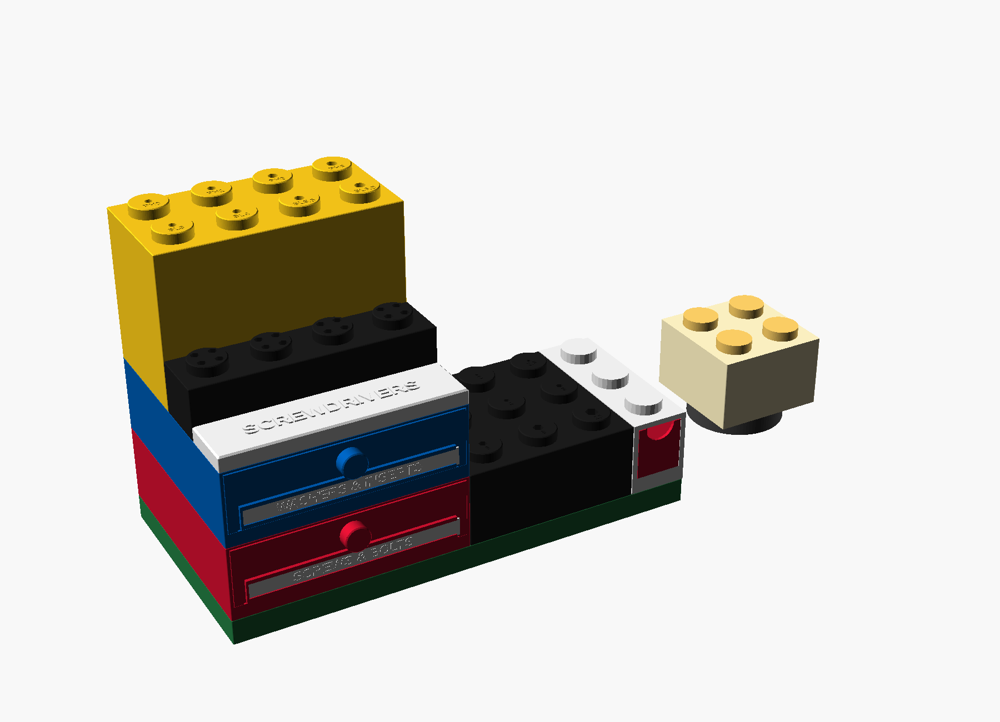
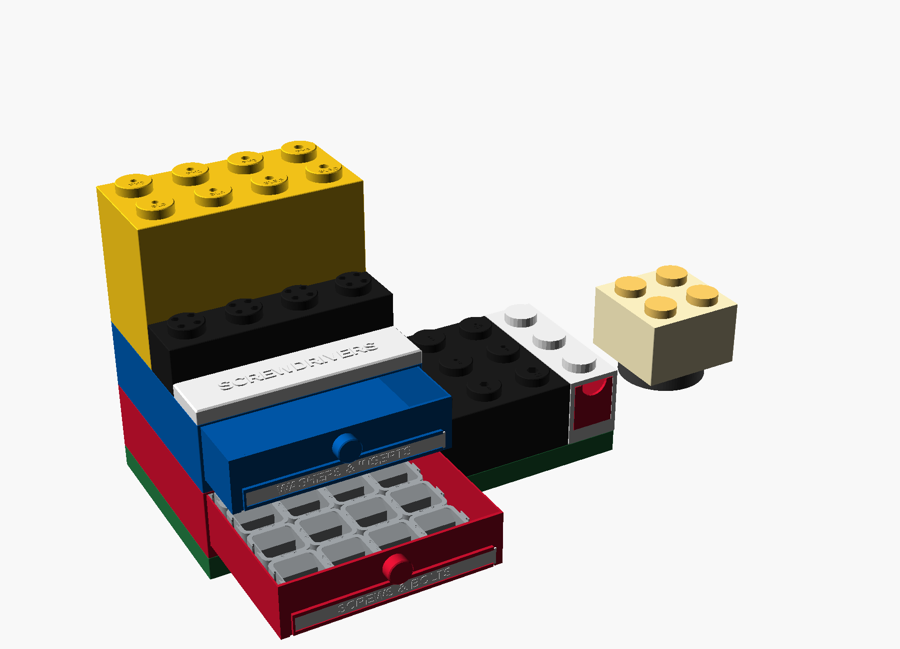
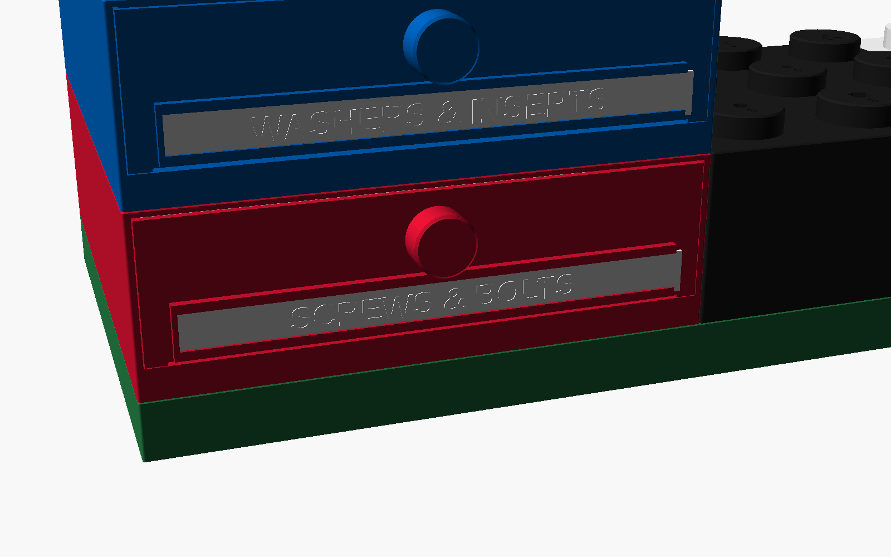
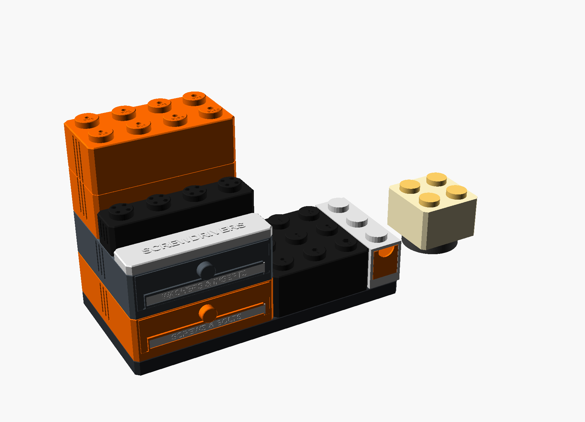

# Brickshop: all-LEGO workshop storage

One parametric OpenSCAD file (`brickshop.scad`). Every part is a giant LEGO brick:
- studs on top, sockets underneath
- 55 mm stud pitch
- 70 mm brick height (3 plates of 23.3 mm)

That's the same scale as the LEGO storage box shells, so your shells and bins snap into the same system.

## Parts (pick with `part =`)

| Part | What it is | Default size | Print |
|---|---|---|---|
| `drawer_brick` | Drawer unit: LEGO shell with studs on top, sockets underneath, and a hex-mesh top between hollow ring studs (the mesh lid is built in). Stack as many as you like; every drawer still opens without moving the others. | 4×4, 1 brick | On its back, opening up (the default layout) |
| `drawer` | Slides into the drawer brick. A giant stud knob is the pull, a nameplate holder sits on the front, and dividers are optional. Holds 16 screw-box modules with 22 mm headroom. **Drawer stop:** it rides on skids, and a bar at the back catches bumps in the brick floor after 199 mm of travel, so it can't fall out. Lift it about 1 mm while pulling to take it out; it rides over the ramp going back in. | 4×4 | Right side up |
| `drawer_spacer` | Frame that sits in the drawer around a block of 4×4 screw boxes, so they can't slide when the drawer opens. Change `spacer_inner` for other blocks. | fits the drawer | Flat |
| `test_kit` | **Print this first.** Two 1×1 plates and a 1×1 tile. Stack them to feel the stud grip, then tune `grip_squeeze` / `fit_gap`. | small | Right side up |
| `nameplate` | Swappable drawer label. It slides into the holder from the right, so a reused drawer can be relabelled. Text is raised for two-colour printing. A paper strip behind a clear plate also works. | fits the drawer width | Flat, text up |
| `storage_box` | Open-top storage brick. Holds 4×4 screw-box modules. Optional dividers. Title engraved on the front. | 4×4, 1 brick | Right side up |
| `box_lid` | Stud lid. Hex mesh between hollow ring studs, title engraved on the front edge. Locks onto the box rim, and another box stacks on its studs. | 4×4 | Right side up, flat |
| `brick` | Plain brick or plate in any size. Use it for baseplates, risers and spacers. | 2×4, 1 brick | Right side up |
| `hex_key_brick` | Hex keys 1.5–10 mm, short arm in the stud, long arm up. Size engraved on each stud. | 3×3, 1 brick | Right side up |
| `driver_brick` | 8 screwdrivers (PH0–PH3, SL3–SL6.5). The shaft drops through the stud and the handle rests on it. | 4×2, 2 bricks | Right side up |
| `bit_brick` | 16 × 1/4" bits, 4 per stud. | 4×1, 2 plates | Right side up |
| `tool_brick` | Your own tool list (see below). Auto-sizes to fit. | any | Right side up |
| `title_tile` | Flat LEGO tile with sockets. Press it onto any studs to label anything. | 4×1 | Right side up |
| `lamp` + `lamp_stud` | 2×2 lamp brick. Twist-locks onto your LED lamp kit base. Press 4 stud caps into the top and they glow. | 2×2 | Lamp upside down, studs closed side down |
| `gridock_lid` | Optional. Turns a Gridock tray into a LEGO base. | 4×4 | Right side up |

None of the parts need supports. Closed bricks have LEGO-style internal ribs and tubes, so their tops bridge only short gaps.

## Customising (no code needed)

Open `brickshop.scad` in OpenSCAD (Window → Customizer) or the MakerWorld customizer.

- **Nameplates:** `np_text`, `np_text_size`, `np_h`. Set `dr_nameplate = false` to engrave `dr_title` on the drawer front instead.
- **Drawers:** `dr_cols`, `dr_rows`, `dr_plates`, `dr_handle` (`stud` or `notch`), `dr_div_x`, `dr_div_y`, `dr_mesh_top`.
- **Any size:** `box_cols`, `box_rows`, `box_plates`, and `brick_cols`, `brick_rows`, `brick_plates`.
- **Titles:** `box_title`, `lid_title`, `tile_text1`. `lid_plaque = true` gives a raised title plaque instead, for the top lid of a stack only.
- **Tools:** `tb_tools` is plain text, for example `hex:2.5, round:8:PH2, square:6.35:1/4`.
  - Tools fill the studs back-left to front-right.
  - `tb_per_stud` = 1, 2 or 4 tools per stud.
  - `tb_depth` = how deep each hole goes.
  - `tb_plates` = brick height.
- **Look:** `style = "classic"` (smooth LEGO) or `"rugged"` (armoured corners, brick seams, grip flutes).
- **Fit:** `stud_grip` and `grip_squeeze` (crush ribs in every socket so bricks click together), `fit_gap`, `hole_clear`, `stud_plug_fit`.
- **Printer:** set `bed_size` to your bed (default 256 mm). OpenSCAD prints a warning when a part is too big.

| classic | rugged |
|---|---|
|  |  |

## Fit check

Every joint was tested with mesh booleans, in both styles, against the original LEGO storage box and screw box files. Nothing collides except the crush ribs, which squeeze each stud on purpose (about 1.5 mm³ of rib per stud at `grip_squeeze = 0.1`). The side play below is the clearance to the socket wall; the ribs take it up.

| Joint | Side play |
|---|---|
| Drawer inside drawer brick | 0.40 mm per side |
| Drawer stop | catches after 199 mm of travel; lifted 0.95 mm it comes out cleanly; going in it clears the ramp |
| Screw boxes in the spacer frame | 0.3 mm per side (13.4 mm without it) |
| Nameplate in its holder | slides out the open end; held by the lips and the end stop in every other direction |
| Drawer brick stacked on drawer brick | 0.50 mm |
| Hex key brick / title tile / your LEGO box shell on a drawer brick | 0.50 / 0.50 / 0.65 mm |
| Stud lid on storage brick rim (tongue in groove) | 0.25–0.35 mm |
| Storage brick stacked on a stud lid | 0.45 mm |
| Driver / bit brick on a stud lid | 0.50 mm |
| Brick on brick, hex key brick on brick | 0.50 mm |
| Title tile on any studs | 0.50 mm |
| Your LEGO box shell on a stud lid | 0.65 mm |
| Storage brick on your LEGO box shell studs | 0.50 mm |
| Neighbouring bricks | 0.40 mm gap |
| 16 screw boxes in a 4×4 drawer | fit (209.6 mm inside, 197.6 mm rugged), 22 mm headroom |
| 16 screw boxes inside a 4×4 storage brick | fit, 27.5 mm headroom under the lid |
| Lamp bayonet vs LED kit shade | 96 % of 6,840 surface samples within 0.3 mm |

Start with `test_kit`: stack the plates and press the tile on. If it's loose, raise `grip_squeeze` (e.g. 0.15); if it's hard to pull apart, lower it (e.g. 0.05). Your LEGO box shells have no ribs, so their sockets stay a loose fit on these studs.

## Not included

The original LEGO storage box, screw box, Gridock and LED lamp files aren't included, because their licences don't allow redistribution. Download them from their MakerWorld/Printables pages.
