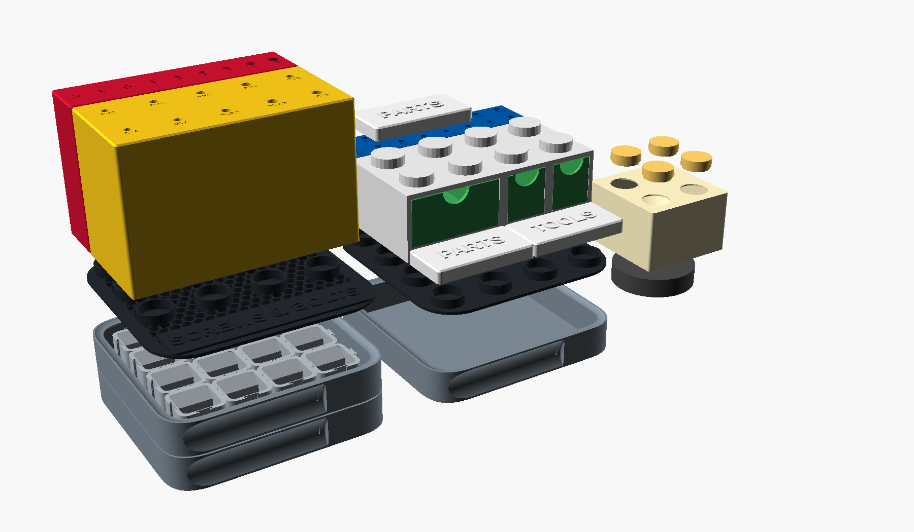

# Brickshop: giant-LEGO workshop storage

One parametric OpenSCAD file (`brickshop.scad`) that ties together:

- **Gridock** stackable trays (220 × 220 mm)
- **LEGO storage box** shells and bins (55 mm stud grid)
- **Modular screw box** (45 mm modules)
- the **LED lamp kit** base

The new parts are a mesh lid with studs and a title, snap-on title tiles, tool bricks and a LEGO-brick lamp.

## The trick: one 55 mm grid

| System | Size | On the 55 grid |
|---|---|---|
| Gridock tray | 220 mm | 4 × 4 studs |
| LEGO storage box shell | 55 mm cells, 34 mm studs, 35 mm sockets | native |
| Screw box module | 45 mm pitch, 30 mm tall | 4 × 4 = 182.8 mm fits inside a Gridock tray (200.4 mm inside) |
| Brickshop parts | 55 mm cells | native, same stud/socket sizes as the LEGO box |

So the stack goes: **Gridock trays of screw boxes → mesh lid (studs on top) → LEGO box shells and tool bricks → title tiles on any studs.**

## Parts

| Part (`part =`) | What it is | Print |
|---|---|---|
| `mesh_lid` | Replaces the Gridock top plate. Hex mesh, ring studs and a raised title plaque. Its foot copies the tray's own bevel, so it nests and self-centres on the rim. | Right side up, no supports |
| `title_tile` | Flat giant tile with sockets underneath. Press it onto any stud row to relabel a stack. | Right side up. Swap filament at the text layer for 2-colour text. |
| `hex_key_brick` | 1×4, 2 bricks tall. Hex holes for L-keys 1.5–10 mm. The long arm goes down, the short arm rests on top. Sizes are engraved. | Upside down (top on the bed), no supports |
| `driver_brick` | 2×4, 2 bricks tall. PH0–PH3, PZ2 and SL3–SL8 screwdrivers. | Upside down |
| `bit_brick` | 1×4, 1 brick tall. 16 holes for 1/4" hex bits. | Upside down |
| `tool_brick` | Your own layout. See "Customising". | Upside down |
| `lamp` | 2×2 giant brick lampshade. The collar is the LED kit's twist-lock (bayonet) re-modelled from measurements. | Upside down (top on the bed), no supports. White or translucent PLA. |
| `lamp_stud` | Hollow glowing stud cap that presses into the lamp top. Print 4. | Closed side down |

Ready-made STLs are in `stl/classic`, `stl/rugged` and `stl/common`.

## Styles

`style = "classic"` gives smooth LEGO bricks. `style = "rugged"` gives armoured chamfered corners, brick seams every 70 mm and grip flutes on the ends. Fit is identical in both.

| classic | rugged |
|---|---|
|  |  |

## Customising (no code needed)

Open `brickshop.scad` in OpenSCAD (Window → Customizer) or the MakerWorld customizer:

- **Tool holes** are plain text, one line per row: `shape:size[:label]`, comma separated.
  Example: `hex:2.5, hex:3, round:8:PH2, square:6.35:1/4 bit`
- **Brick size**: `tb_cols`, `tb_rows`, `tb_height` (in bricks of 70 mm). Long-series hex keys need `tb_height = 3`.
- **Lid**: `lid_title`, `lid_stud_rows` (4 = full stud grid, 3 = front row becomes the title plaque).
- **Lamp**: `lamp_cols`, `lamp_rows`, `lamp_h`, and `collar_drop` if your LED base needs the collar lower.
- **Fit**: `fit_gap`, `hole_clear`, `stud_plug_fit`.

## Fit check

Every mating pair was checked with mesh booleans against the original files:

| Joint | Overlap | Side play |
|---|---|---|
| LEGO box shell 4×4 on mesh lid (16 studs) | 0 mm³ | 0.65 mm |
| LEGO box shell 2×2 on mesh lid | 0 mm³ | 0.65 mm |
| Title tile on mesh lid | 0 mm³ | 0.50 mm |
| Title tile on LEGO box shell studs | 0 mm³ | 0.50 mm |
| Hex key brick on mesh lid / on LEGO box shell | 0 mm³ | 0.30 / 0.35 mm |
| Driver brick on mesh lid | 0 mm³ | 0.30 mm |
| Neighbouring bricks | 0 mm³ | 0.40 mm gap |
| Mesh lid on Gridock tray | seats 0.48 mm into the rim saddle and self-centres (rises when pushed sideways) | |
| Lamp bayonet vs LED kit shade | 96 % of 6,840 surface samples within 0.3 mm. Max tight spot 0.36 mm at one edge of the stop wall. | |

Both styles give the same numbers. Tip: print one `title_tile` with `tile_len = 1` first to check stud grip on your printer, and adjust `fit_gap` if needed.

## Not included

The original Gridock, LEGO storage box, screw box and LED lamp files are not included, because their licences don't allow redistribution. Download them from their MakerWorld/Printables pages. The Rugged Screw Unit XL download contained only its label generators, so it isn't part of the stack yet.
